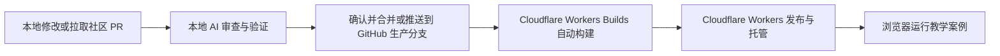

# Feynman 总体架构

更新：2026-10-13。首期 v0.1.0 已上线；Git 自动发布与扩展部分仍待实施。长期优先级、阶段目标与推进条件统一见 [开发路线图](ROADMAP.md)，本文维护技术结构和边界。

前端已统一为 Next.js App Router + output:export，详见 [迁移方案与实施状态](archive/2026-10-13-nextjs-migration.md)。27 个三语言内容 URL 在构建时渲染，实验使用局部客户端会话，默认产物 out。原 Vite 入口和正常页面预渲染器已移除；Vitest 仍使用 Vite 依赖。迁移版本已于 2026-10-13 发布并完成线上验收，来源 ccedbd2；实际版本见部署记录。

已实现：Next.js 静态导出前端、四个实验、英文默认及中文/日文界面与讲解、构建时清单校验与可信懒加载映射、目录搜索、预渲染讲解、参数与播放控制、运行时完整快照接口、模型与浏览器验证。实验页不提供倍速、视角缩放或状态导入导出入口。未实现：独立发行 SDK/CLI、电学工作台、Worker/WASM、历史版本归档、Workers Builds 的 GitHub 自动构建关联。原 Vite 版本已通过 Workers Static Assets 正式部署到 https://www.feynman-technique.com。实际开发入口见 [本地开发](DEVELOPMENT.md)。

## 1. 当前结论

目标为 **本地 AI 审查与验证 → GitHub 源码管理 → Cloudflare Workers Builds 自动构建发布**。目前 Git 集成尚未关联，实际发布由本地构建后通过 Wrangler 上传；Git push 只保存源码，不触发上线。当前不建设自定义后端、登录系统、数据库、ORM、Serverless Functions 或运行时 AI 接口。

维护者在本地用 AI 审查自己的修改或拉取的 PR，并运行相关测试和构建验证；确认后合并或推送到 GitHub 的生产分支。Cloudflare Workers 通过内置 Git 集成自动获取更新、构建并托管网站。访问者浏览器负责交互、模型计算和渲染。项目不配置 GitHub Actions，也不开发 webhook 服务或单独调用部署钩子。

案例源码、讲解、署名、版本以 Git 为唯一来源，构建时生成目录和搜索索引。贡献者提交 PR，检查与 AI 审查通过、维护者确认合并后发布新前端。AI 审查属于开发流程，不需要网站后台支持。

## 2. 当前技术栈

| 部分 | 推荐 | 职责 |
|---|---|---|
| 前端 | TypeScript + React + Next.js App Router 静态导出 | 页面、案例源码与静态构建；内容在构建时渲染，计算与绘图在浏览器运行 |
| 样式 | CSS Modules + CSS Variables | 视觉还原与多实验主题 |
| 三维 | Three.js + React Three Fiber | 三维场景、相机与对象交互 |
| 二维 | SVG + Canvas 2D | 函数、几何与轨迹 |
| 公式 | KaTeX | 公式排版 |
| 计算 | TS 纯函数；按需 Web Worker | 在访问者设备运行模型 |
| 可选计算模块 | Rust → WASM | 实测有瓶颈后再增加，仍随前端发布 |
| 内容 | Git 中的 JSON、Markdown、TS/TSX | 案例、目录与文档 |
| 本地验证 | Vitest + Playwright + 本地 AI 工具 | 数值、交互、视觉和教学检查 |
| 生产构建 | 当前本地；目标 Cloudflare Workers Builds | 关联后生产分支更新自动构建发布，目前由本地构建和 Wrangler 上传 |
| 托管 | Cloudflare Workers Static Assets | 文件分发、域名和 HTTPS |

不再为“需要一个文件服务器”开发 Go/Rust 服务；现成托管承担此职责。Rust 仍可作为浏览器计算模块的实现语言，但不是当前必需项。参考视觉保持 [视觉规范](VISUAL_SPEC.md) 中的设计。

Workers Static Assets 直接托管 Next 静态导出产物，配置不需要应用脚本。[Static Assets](https://developers.cloudflare.com/workers/static-assets/get-started/)

## 3. 构建与运行

| 阶段 | 地点 | 行为 |
|---|---|---|
| PR 检查 | 维护者本地环境 | 拉取 PR，用 AI 检查源码和教学内容，运行相关验证 |
| 生产构建 | 当前维护者本机；关联后 Cloudflare Workers Builds | 从源码输出 HTML、CSS、JS、JSON、模型与可选 WASM，当前未自动获取 Git 更新 |
| 页面交付 | Cloudflare Workers | 将现成产物交付浏览器 |
| 实验运行 | 用户电脑或手机 | 改参数、计算模型、绘图与播放 |

例如将单摆长度从 1m 改为 2m，浏览器根据已经下载的案例程序计算新的运动并绘图；不访问计算服务器，也不重新构建网站。“静态”描述交付方式，不代表页面只能展示图片或文字。

简单公式在主线程计算，较重任务放进 Web Worker 避免界面阻塞。Worker 不会自动加速算法。必要时 Rust 编译出的 WASM 也在浏览器运行，无需 Rust 服务器。固定且昂贵的数据可以在构建时预计算。[Web Worker](https://developer.mozilla.org/en-US/docs/Web/API/Web_Workers_API/Using_web_workers)、[WebAssembly](https://developer.mozilla.org/en-US/docs/WebAssembly)

## 4. 当前发布与目标自动流程

完成 Git 关联后的目标流程：

自有改动：本地开发 → 本地 AI 审查、相关测试与构建验证 → 推送 GitHub 生产分支 → Cloudflare Workers 自动构建并发布。

社区贡献：贡献者提交 PR → 维护者拉取 PR 到本地 → AI 审查并验证拟合并结果 → 修正并重验（如需要）→ 确认合并到生产分支 → Cloudflare Workers 自动构建并发布。PR 通常已在 GitHub 上；维护者审查通过后执行的是合并或推送整合后的代码。

在 Workers Builds 中关联 geoochi/feynman-technique，根目录 frontend、生产分支 main、构建 pnpm build、部署 pnpm deploy:workers。当前 Wrangler 上传更新同一个 Worker；完成关联后，生产分支推送才由 Git 集成自动发布。具体设置与授权步骤见 [部署指南](DEPLOYMENT.md)。不添加 Actions 或 webhook。

当前关闭 workers.dev 和版本预览 URL，不开启非生产分支自动构建。将来启用预览时，非 main 分支构建强制 noindex，预览不等于正式发布。

Cloudflare Workers 不会知道本地 AI 是否审查过。当前由维护者掌握生产分支的合并/推送权限，在本地确认后才更新该分支；不配置不存在的 CI 状态检查来阻塞合并。审查记录应注明目标版本，推送前基线改变则复核最终整合结果。



## 5. 目录与配置边界

```text
feynman/
  frontend/
    package.json / pnpm-lock.yaml / pnpm-workspace.yaml
    app/                      # 英文/本地化静态路由与根布局
    apps/web/                 # 页面实现、静态组件与客户端实验会话
      generated/              # 构建生成的元数据与可信 import 映射，不提交
    packages/
      core/                   # 案例类型与数值参数校验
      runtime/                # 固定步长时钟与快照恢复
      ui/                     # 控件、公式与场景样式
      i18n/                   # 语言、路由、类型化界面文案与语言切换
      seo/                    # 共用页面枚举、纯元信息规则与 Next Metadata 适配
    examples/
      math/function-transform/
      physics/pendulum/
      geography/day-night/
    scripts/                  # 清单校验、公式编译、目录生成、导出检查
    tests/                    # 状态测试、Playwright 浏览器测试
    public/                   # 品牌标识与生成的封面、目录、搜索索引
    wrangler.jsonc            # Workers Static Assets、HTML 路由及自定义域名
    site.config.ts            # 正式域名，不从预览 URL 推断
    out/                      # 普通静态产物，不提交 Git
  tooling/ai-review/           # 本地审查指南
  docs/
```

这是已实现的首期结构。共用模块暂不独立发布为包；二维视图和纯 TS 模型在各案例内，三维依赖仅由地球案例引入。没有 backend/、服务器任务、数据库配置或 GitHub Actions。

工具链固定为 Node 24.11.1、pnpm 12.10.1，依赖使用 lockfile。Workers Builds 设置 NODE_VERSION 与 PNPM_VERSION，不能沿用平台默认 pnpm 版本。部署配置已经写入仓库；已完成授权和首次上传，Git 集成仍未连接；最新状态以 [部署指南](DEPLOYMENT.md) 为准。

本地 AI 使用维护者已有工具与授权，不将 AI 密钥放入仓库、Cloudflare Workers 构建变量或 VITE_*。静态网站生产构建不需要 AI 服务。构建只依赖已提交源码、锁定的依赖和公开资源。

## 6. 前端内容与案例协议


案例提交后已经是前端源码的一部分。合并 PR 即完成正式纳入，不需要 AI 再把整份案例复制到另一个大文件里。构建脚本校验 manifest、自动生成目录与静态 import 映射，由打包器建立按案例拆分的 chunk。

新增案例只需增加案例目录，通常不改中心路由或后端。使用构建时枚举的 import 映射，不从访客 URL 或外部 manifest 拼接任意可执行模块地址。

| 页面 | 数据与行为 |
|---|---|
| 首页 | 构建生成的 catalog.json、分类与搜索索引 |
| 实验页 | 按需加载对应案例代码和资源 |
| 学习页 | Markdown 构建为静态 HTML，带标题与 SEO 元数据 |
| 贡献与源码信息 | 公开 GitHub 仓库、首页 Issue/PR 投稿区；网站省略个人署名 |
| 本地预设 | 仓库 JSON 用于构建校验与维护参考；实验页没有导入导出入口 |

无需建立登录、个人中心、云端短链接或服务端进度接口。如保存学习进度，仅存本机 IndexedDB/localStorage，并明确清理浏览器数据会丢失记录，不做跨设备承诺。

Next 在构建时渲染正常页面；scripts/finalize-next.ts 只整理本地化首页文件、语言 404 与 robots/sitemap，不重写正常正文或移动 RSC 载荷。Server Components 持有完整内容，客户端只接收当前页需要的投影。模型/读数与场景由校验通过的显式映射分别加载，地球 Three/R3F 不进入首页或讲解；公式在构建时编译。科学模型仍为纯 TS。

### 三语言内容与路由

语言代码为 en、zh-CN、ja，默认英语。英文沿用 `/`、`/labs/slug`、`/learn/slug`；中文增加 `/zh/` 前缀，日文增加 `/ja/` 前缀。URL 确定语言，各页面用语言下拉框选择 English / 中文 / 日本語，并保留当前实验或文章；关闭 JavaScript 时以语言链接作为回退。JavaScript 启用时跨语言导航交接完整快照，目标页恢复参数、时间、内部状态与播放状态；直接加载或刷新页面仍按原规则创建新实验。

界面公共文案位于 packages/i18n；实验图中说明与读数文案位于各案例 labels.ts。科学模型、参数 key、数值边界、公式变量、slug、纹理与快照共用，locale 属于页面状态，不进入科学模型或快照。Manifest schemaVersion 升为 2：标题、简介、标签、学习目标、先修知识、模型假设均按三种语言存储；参数 schema 保留英文 title 并增加 labels，讲解分别维护 lesson.en.md、lesson.zh-CN.md、lesson.ja.md。

构建校验三种语言完整性和七章顺序，以稳定章节 id 定位问题，不依赖翻译后的标题。每语言生成独立搜索索引以及首页、404、实验入口和讲解页，当前共 24 个 HTML 页面。预渲染与客户端使用同一语言解析规则，设置对应 html lang、标题和描述；关闭 JavaScript 仍可读对应语言的文章。通过 Workers auto-trailing-slash 提供无扩展名的静态路径。

首页只传当前语言卡片与搜索字段，完整三语言内容集合仅在构建侧使用。运行时只接受 RuntimeLabConfig；语言不进入科学快照。跨根布局用短期 sessionStorage、一次性导航标识与 history.state 交接快照及 playing，刷新初始化新实验，BFCache 恢复后再启用控件。

### SEO 与静态页面

当前 SEO 由 Next Metadata API 适配既有纯元信息规则，以下规则继续适用。公共页面枚举供静态路由、导出检查和 sitemap 共用，软导航和语言页面均使用同一元信息规则。正式主域名配置为 `https://www.feynman-technique.com`（裸域 301 到 www，已线上验收），每个内容页输出独立标题/描述、绝对 canonical、三语言 hreflang、分享信息与基于真实内容的 JSON-LD；当前 sitemap 含 27 个可收录页面。实验入口静态 HTML 包含核心问题及讲解链接，讲解页提供完整文章。404 和预览环境 noindex，科学模型及部署流程不变。www 绑定、HTTPS 与裸域重定向已配置并验收，维护者已确认提交 sitemap，但 Agent 未独立读取 Search Console 的索引或搜索报告；当前规则与观测待办见 [SEO](SEO.md)，首轮计划已归档。

## 7. 实验 SDK 的边界

当前实现以主图为中心的课程布局（最左侧简介及 1–3 个实验问题、中央主图、右侧统一控制及其下方公式与读数），以及目录/暖纸/天文主题与最小共享运行时。实验页取消七步导航和快速探索下拉框，参数可直接修改或恢复默认值；单摆长度按比例绘制，实验页移除学习目标与适用条件、检验理解、依据来源区块，完整讲解保留在独立静态页面。view.tsx 仅导出绘图组件，controller.ts 导出 model/Readouts；自由搭建式电学工作台仍是后续设计。具体尺寸见视觉规范。共享模块只抽象三个种子案例已经使用的能力，未独立发行 SDK。

核心契约包括参数校验、create、setParams、step、reset、snapshot、restore、dispose；UI 状态、计算模型和渲染状态分离。模型用纯函数或独立状态对象表示，不依赖 React 组件内部变量。

时间模拟使用固定步长或明确的积分策略；随机实验记录 seed；快照携带案例版本、参数、模拟时间和必要的内部状态。只保存参数不能还原有历史依赖的实验。模型标明单位、假设和误差，不能把动画效果当作科学正确性的证明。

性能目标是待验证预算：桌面以 60fps、移动低质量档以 30fps 为目标；典型参数操作 P95 <100ms。低端设备可降低粒子数与画质，WebGL 不可用时提供静态图和讲解。后端语言不会改变访问者 GPU 的能力。

## 8. AI 审查与发布策略

审查的输入是 PR diff、相关模型/依赖、讲解、自动测试结果和截图；输出是结构化的问题、证据、严重性、科学假设与审查覆盖范围。AI 可以指出公式错误、遗漏边界、教学歧义和危险代码，但“AI 通过”不是数学或软件无误的证明，必须与确定性测试结合。

推荐规则：校验/类型/模型/构建测试全部通过，AI 无未解决阻断项，维护者确认目标版本后合并。对模型不确定或缺少引用的结论，保留明确待核实项。若 AI 代为修改 PR，修改后的版本重新运行检查。

审查结论绑定 commit SHA 与被测试的合并结果；PR 新提交或基线变化后重验受影响项。模型超时、额度耗尽或输出解析失败是“未完成审查”，不能视为通过。后续可自行选择为低风险改动启用自动合并，但这里不默认替维护者开启。

AI 读取的 PR、注释与文档是待分析数据，不应改变维护者的审查要求。未知 PR 先检查脚本和依赖；需要执行时使用不带生产凭据的隔离工作目录或环境。AI 修复后对最终代码重新验证，再由维护者合并或推送。这里只设计本地工作流程，不建设常驻审查服务。

详细案例文件、审查清单和贡献流程见 [案例贡献设计](CONTRIBUTING_DESIGN.md)。

## 9. 静态托管的实现与验收

当前目录、实验框架和学习文章通过 Next 构建生成静态 HTML；实验视图按案例懒加载。frontend/wrangler.jsonc 使用 Static Assets，auto-trailing-slash 将 labs/slug.html 提供为 /labs/slug，将 zh/index.html 提供为 /zh/，HTML 别名重定向到规范路径。404-page 按最近语言目录返回真实 404，没有全站 SPA 重写。public/_headers 配置哈希资源长缓存及预览域名 noindex。

通过 Workers Builds 记录追溯 commit SHA、构建和部署版本。正式发布后核对域名、深链接、资源、索引信息与目标提交；故障时使用平台 Version History 回滚到已验证版本。首次本地上传不代表已经接通 Git 自动发布。

带内容哈希的资源使用长缓存，HTML 入口允许更新。长期打开的页面需要应对部署后懒加载 chunk 失效：验证部署平台的保留行为，并保留资源失败回退与刷新提示；当前实验页不提供状态导出，若以后设计状态恢复需单独实现和验证，不能未经验证就承诺旧页面永远可运行。需要长期固定的教案，另提供固定发行版本的可下载静态包。

模型、纹理、视频按案例加载并控制大小；大型资源是否放独立对象存储由实际产物规模决定。Cloudflare Workers 不等于无限免费托管，部署前检查当时套餐适用条件、资源配额及目标地区实际访问表现；本方案不作价格或国内网络可用性的保证。

完成标准：

- 访问者无需登录即可打开、调参、重置和学习。
- 浏览器运行不依赖自定义 API、数据库或线上 AI 服务。
- 新案例通过 PR、本地验证、本地 AI 审查和确认合并后，由 Cloudflare Workers 构建并发布。
- 项目没有 Actions workflow；接入 Git 集成后生产构建由 Cloudflare Workers Builds 触发，发布版本与本地审查记录可追溯。
- 首页与实验深链接可直接访问；丢失资源正确报错。
- 发布后可验证正式 URL，并能回退到此前验证的版本。
- 纯静态产物可迁移到其他托管平台，不依赖应用后端或平台专有数据存储。

当前课程壳、十七个案例、贡献指南与本地验证已具备。后续按 [开发路线图](ROADMAP.md) 并行推进真实使用反馈、Git 自动发布、内容扩展与外部贡献；工具与大型工作台按明确需求逐项设计，不将它们作为首期能力。

只有未来明确增加必须保密的在线 API、跨设备用户数据或服务端重计算时，才重新讨论应用后端。当前不为这些假设建设服务。

网站通过 GitHub 导航和三语言首页投稿区开放源码阅读与 Issue/PR 贡献。源码 manifest 与素材来源保留真实作者；generate.ts 清空浏览器数据的作者数组，JSON-LD 不输出 author，网站不展示个人署名。贡献指南在公开仓库维护，三语言 /contribute 仍返回 404，不进入 sitemap；第三方法定版权通知保留。
