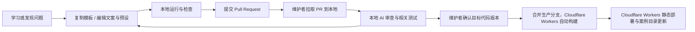

# 案例协议与社区贡献设计

更新：2026-10-13。协议首期 v0.1.0，案例文件契约已适配 Next 迁移。已实现仓库内核心类型、数值参数与快照校验、清单生成和十二个案例；独立 SDK/CLI、脚手架和完整社区机制仍待实施。实际入口见 [本地开发](DEVELOPMENT.md)，社区与工具的后续推进条件见 [长期路线图](ROADMAP.md)。

## 1. 一份贡献是什么

一个案例应回答一个清晰问题，例如“为什么改变振幅会影响大角度单摆的周期”。贡献者可以从纠正文案、增加一个参数预设、提出一道题开始，再进阶到新实验和底层算法。

贡献难度分三层：

| 路径 | 需要提交 | 适合谁 |
|---|---|---|
| 讲解/翻译/预设 | Markdown、JSON、引用 | 学习者、教师 |
| 新案例 | manifest、模型、视图、讲解和测试 | 会基本 TS/React 的贡献者 |
| SDK/求解器 | 算法、接口、兼容性与数值验证 | 熟悉计算与图形的开发者 |

现已提供实验想法与错误反馈 Issue 模板，非程序员也可提出案例草稿；网页创作器放到案例协议稳定之后。社区讨论可以使用 GitHub Discussions 的问答和展示区，当前尚未启用这些仓库功能。[GitHub Discussions](https://docs.github.com/en/discussions)

## 2. 案例包目录

以下路径相对于仓库的 frontend/；案例源码与构建依赖位于前端工作区。

```text
examples/physics/pendulum/
  manifest.json               # 可静态读取的元数据
  parameters.schema.json      # 参数 JSON Schema
  snapshot.schema.json        # 内部状态恢复格式
  model.ts                    # 不依赖 UI 的科学计算
  view.tsx                    # 仅绘图与底部简短声明
  readouts.tsx                # 读数与公式标记；不导入绘图
  controller.ts               # 仅导出 model 与 Readouts
  formulas.json               # 三语言静态公式，构建为 HTML/MathML
  lesson.zh-CN.md             # 原理与探究引导
  lesson.en.md                # 英文讲解（默认）
  lesson.ja.md                # 日文讲解
  labels.ts                   # 图中标注与读数的三语言文案
  presets.json                # 有限组可校验的参数
  questions.json              # 构建校验的自测题
  model.test.ts               # 数值/边界测试
  preview.svg                 # 自有或获许可的封面
  assets/                     # 模型/纹理等
  ATTRIBUTION.md              # 素材作者、来源、许可证
```

元数据使用 JSON 而不是任意可执行 TS，目录构建器无需执行案例代码就能获取标题和标签。注册表由扫描与校验生成，不要求每位作者修改中心路由文件。

## 3. Manifest 示例

```json
{
  "schemaVersion": "2",
  "id": "physics.pendulum",
  "slug": "pendulum",
  "version": "0.1.0",
  "sdkRange": "^0.1.0",
  "title": {
    "en": "Pendulum and time",
    "zh-CN": "单摆与时间",
    "ja": "単振り子と時間"
  },
  "summary": {
    "en": "Change a string's length and explore what sets the period.",
    "zh-CN": "改变一根细线的长度，探究周期从何而来。",
    "ja": "糸の長さを変えて、周期が何で決まるかを探る。"
  },
  "subjects": [
    "physics"
  ],
  "levels": [
    "high-school"
  ],
  "tags": {
    "en": [
      "oscillation",
      "period",
      "energy"
    ],
    "zh-CN": [
      "振动",
      "周期",
      "能量"
    ],
    "ja": [
      "振動",
      "周期",
      "エネルギー"
    ]
  },
  "learningObjectives": {
    "en": [
      "Explain the square-root relationship between length and period",
      "Distinguish the nonlinear model from the small-angle approximation",
      "Understand the exchange of kinetic and potential energy"
    ],
    "zh-CN": [
      "解释周期与摆长的平方根关系",
      "区分非线性模型与小角度近似",
      "观察动能与势能的转换"
    ],
    "ja": [
      "長さと周期の平方根の関係を説明する",
      "非線形モデルと小角近似を区別する",
      "運動エネルギーと位置エネルギーの交換を理解する"
    ]
  },
  "prerequisites": {
    "en": [
      "trigonometry",
      "gravity",
      "energy"
    ],
    "zh-CN": [
      "三角函数",
      "重力",
      "能量"
    ],
    "ja": [
      "三角関数",
      "重力",
      "エネルギー"
    ]
  },
  "estimatedMinutes": 15,
  "layout": "lesson",
  "theme": "paper",
  "renderer": "svg",
  "entry": "view.tsx",
  "parameterSchema": "parameters.schema.json",
  "snapshotSchema": "snapshot.schema.json",
  "locales": [
    "en",
    "zh-CN",
    "ja"
  ],
  "lessons": {
    "en": "lesson.en.md",
    "zh-CN": "lesson.zh-CN.md",
    "ja": "lesson.ja.md"
  },
  "preview": "preview.svg",
  "authors": [
    {
      "name": "geoochi"
    }
  ],
  "licenses": {
    "code": "MIT",
    "content": "MIT"
  },
  "capabilities": {
    "network": false,
    "audio": false
  },
  "modelAssumptions": {
    "en": [
      "No drag; a massless, inextensible string and a point-mass bob",
      "Fixed-step RK4 integration; the small-angle formula is a comparison only"
    ],
    "zh-CN": [
      "无阻力、不可伸长的轻绳、质点摆球",
      "固定步长 RK4 数值积分；小角度公式只用于近似对照"
    ],
    "ja": [
      "抵抗なし。質量のない伸びない糸と質点の振り子",
      "固定刻みの RK4 積分。小角近似の式は比較用"
    ]
  },
  "references": [
    {
      "title": "OpenStax · Pendulums",
      "url": "https://openstax.org/books/university-physics-volume-1/pages/15-4-pendulums"
    }
  ],
  "status": "experimental"
}
```

上例来自当前单摆案例，schemaVersion 为 2。发布检查要求三语言文案与讲解完整，并补齐有效引用、素材来源、可运行文件和审阅记录。

2026-10-11 维护者明确授权原创代码、讲解、文档与图示统一采用 MIT，正式条款见根目录 [LICENSE](../LICENSE)。案例清单的 code 与 content 均标记 MIT；NASA 地球贴图、第三方依赖和字体保留自身条款，不纳入项目 MIT 授权。ATTRIBUTION.md 和第三方许可通知记录这些例外。原创贡献按 MIT 提交，保留贡献者署名，不要求转让版权。[MIT 正文](https://opensource.org/license/mit)

三个版本字段的职责不同：schemaVersion 控制元数据格式，version 控制案例内容，sdkRange 控制运行时兼容性。更新模型应更新案例 version。当前清单记录覆盖 manifest、schema、模型、视图、labels.ts、测试、三语言讲解、预设、题目、封面、来源声明的 contentHash；JS 使用 Next 内容哈希文件名。路由只承载当前版本，快照严格拒绝其他版本；尚无 id + version 路由或旧发行归档，不承诺旧链接固定行为。

## 4. 参数、状态与教学联动

参数必须有类型、默认值、范围、步长、单位和标签。title 是英文默认名称，labels 存放 en、zh-CN、ja 的完整标签，按当前语言显示说明及括号内的公式符号，例如“Length (L)”“摆长（L）”“振り子の長さ（L）”；不把内部字段名 length 当作公式符号。SI 单位作为模型内部标准，角度在 UI 显示为度时显式转换为弧度；参数改变、计算和显示不能各自保留不同的隐式单位。

示意参数表：

| key | 默认值 | 范围 | 模型单位 | 教学作用 |
|---|---:|---|---|---|
| length | 1 | 0.2–3 | m | 比较周期 |
| gravity | 9.81 | 1–20 | m/s² | 比较不同重力条件 |
| angle | 0.174533 | -1.396263–1.396263 | rad | 对比小角度与大角度 |

内部运行时快照的数据外层至少包含（当前实验页不提供状态导入导出入口）：

```text
labId, labVersion, sdkVersion, snapshotSchemaVersion,
params, seed, simulationTime, internalState, camera, activeChapter
```

构建时预设与内部恢复接口校验参数。非法数值、NaN、过大的数组、未知字段和不支持的版本不能直接进入计算模型。JSON 文件分享与 URL fragment 是未来协议设计，当前界面没有这些入口；URL 不放个人信息，不建立服务端快照存储。

当前 view.tsx 只导出默认绘图组件；readouts.tsx 导出 Readouts，controller.ts 只重导出 model 和 Readouts，不可导入 view。类型见 frontend/packages/core/types.ts；清单生成器分别生成可信控制器、场景和静态贴图映射，无需手改中心路由。formulas.json 按公式 id 提供完整三语言 LaTeX；构建以 trust:false 编译为 HTML/MathML，Readouts 使用 FormulaMarkup，浏览器不下载 KaTeX 排版 JS。绘图只包含场景与底部一条声明；课程壳把全部控制放到右侧，Readouts 放到右侧实验控制下方，与控制共用一列，介绍和 1–3 个以问号结尾的问题放到最左侧；问题维护在各语言讲解的首章，由稳定 id problem 定位。实验页不显示学习目标与适用条件、检验理解、依据来源区块，单摆移除单位质量总能量读数。实验页没有七步导航、快速探索下拉框、倍速、视角缩放或状态导入导出入口，操作讲解应给出实际参数值。提供“重置参数”恢复 schema 默认值；绘图不能用按当前参数自动缩放掩盖实验变化。七章内容用于完整静态讲解；快照 activeChapter 为首版兼容字段。

不随时间变化的案例可在 manifest.json 声明 `"playback": false`，课程壳会移除播放区、模拟时间和暂停状态，并且不启动动画时钟；未声明时保留动态控制。二次函数使用此设置，仅通过 a、h、k 调参。

模型、视图、讲解的数据使用稳定参数名；以下章节联动 SDK 接口为未来设计。案例作者不能依赖网站私有 DOM id，也不能随意修改网站全局样式。SDK 应提供“突出某个对象”“切换预设”“推进教学步骤”等最小接口，复杂故事仍可在案例内编排。

## 5. 一份合格讲解

三语言完整讲解均保留七章，标题和顺序见 frontend/packages/i18n/locales.ts 的 chapterTitles，章节 id 共用且稳定。讲解依次提出问题、预测、操作、观察、解释、验证、延伸；翻译应保持公式、单位、近似条件及问题含义一致。公共界面翻译位于 packages/i18n/messages.ts，案例图示和读数翻译放在自己的 labels.ts，使用 useI18n 获取 locale。

每个案例至少交代学习目标、先修知识、操作方法、数学/科学依据、近似条件、一个值得思考的问题，以及作者和来源。允许简洁，不能只剩一张漂亮动画。

例如单摆先让学习者预测摆长变成四倍会发生什么，再计时比较，最后呈现公式和近似条件。答案不能用动画的表现替代推导，也不能把小角度公式应用到所有振幅而不说明。

自测题用于学习反馈，首期答案可随静态包发布，不用于正式考试评分。将来若做受控考试，需独立设计题目保密、评分和隐私机制。

## 6. 从学习到 PR

当前可用命令：

```sh
cd frontend
pnpm install --frozen-lockfile
pnpm dev
pnpm check:lab
pnpm typecheck
pnpm build
pnpm test:e2e
```

新案例目前复制现有目录并编辑元数据、模型、视图和讲解；没有 create:lab 或 --lab 参数。pnpm check:lab 校验全部清单并运行全部模型与状态测试。清单支持 lesson 布局、英文/中文/日文、有限数值参数；参数的 step/unit/title/labels 属于项目 JSON Schema 注解，step 是 UI 步长而非 multipleOf 约束（避免弧度预设和浮点除法被错误拒绝）。协议稳定后再增加脚手架和独立 CLI。案例作者只启动前端即可预览，不要求 API 密钥、云账户或数据库。



PR 模板要求说明：学习目标、交互方式、模型假设、预期结果、截图、测试、引用、许可证、是否修改公共 SDK。纯文字纠错走轻量流程；算法修改需数值证据、AI 对假设与引用的审查，涉及无法确认的学科结论时交给具备相关知识的人核实。

案例 PR 本身就是前端源码的变更，合并即完成纳入。构建脚本扫描 manifest 并生成注册表，自动接入目录和懒加载入口，无需逐次手写后端路由。AI 若修正代码，修正后重新检查，而不是复制到另一个隐藏的内容源。

## 7. AI 审查契约

AI 审查在维护者本地工具中完成，不配置 GitHub Actions。网站运行时不调用 AI，也不建设审查后端。读取代码 diff、相关上下文、讲解、引用、测试结果与截图，输出：

- 被审查的 commit SHA 和被测试的合并结果。
- 工程问题：文件/位置、严重性、可复现证据、建议修复。
- 教学问题：公式、适用条件、误差、单位、讲解歧义与引用。
- 结论：通过、需要修复、需要补充证据；注明实际检查范围。

相关本地测试与构建验证通过且 AI 无未解决阻断项后，由维护者确认合并或推送。AI 的结论不能替代已知解、边界与守恒量测试；超时或失败保持“未完成”。新增提交使旧审查失效，AI 生成的修复也需重新验证。

PR 内容是审查对象，不能改变维护者要求。AI 使用维护者本地已有工具和授权；不把模型密钥提交到仓库或提供给前端构建。未知 PR 先阅读脚本与依赖，再在不带生产凭据的隔离环境验证。最终由维护者控制生产分支更新，完成 GitHub 关联后 Cloudflare Workers Builds 据此自动构建发布（当前仍为本地 Wrangler 上传）。具体流程见 [总体架构](ARCHITECTURE.md)。

## 8. 本地验证清单

| 检查 | 内容 | 失败时 |
|---|---|---|
| 清单校验 | 唯一 id/slug、合法路径、必填字段、版本兼容、引用 | 指向具体字段 |
| 文件与资源 | 缺失文件、越界路径、单资源大小、来源说明 | 拒绝发布 |
| 类型与构建 | TypeScript、依赖、独立案例打包 | 提供构建诊断 |
| 科学模型 | 已知解、边界、误差、守恒量或单调关系 | 不以视觉替代数值验证 |
| 交互冒烟 | 加载、改参、暂停、重置、恢复 | 保留失败截图 |
| 视觉 | 指定视口、固定时间/种子/相机的基线 | 差分图供审阅 |
| 访问性 | 键盘、名称、焦点、替代文字与减少动效 | 缺陷需修复或说明 |
| 产物预算 | 首包、纹理尺寸、明显卡顿 | 超预算需理由和优化 |

不要为每个文案改动重复跑所有重型实验。根据依赖图检查受影响案例；SDK 或共享渲染器变更才扩大范围。共享 SDK 或渲染器发行前，在本地扩大兼容性验证范围。

## 9. 社区维护机制

当前已提供根目录 CONTRIBUTING.md、三语言 README、实验想法/错误反馈 Issue 模板与 PR 模板。根目录 LICENSE 已提供正式 MIT 条款；CODE_OF_CONDUCT、GOVERNANCE、SECURITY 等按实际需求后续建立。按学科和 SDK 设置 CODEOWNERS，但在实际维护者加入前不编造用户名。CODEOWNERS 可以定义路径负责人，并配合仓库规则要求其审阅。[GitHub CODEOWNERS](https://docs.github.com/en/repositories/managing-your-repositorys-settings-and-features/customizing-your-repository/about-code-owners)

维护者分工：核心维护者管理 SDK 与发行；学科维护者审查教学与模型；贡献者提交案例、纠错、翻译与预设。同一人可兼任，不为每份贡献强制组织复杂委员会。

当前十二个案例均标为 experimental，源码 manifest 保留作者，公开网站只展示版本、依据与模型限制，没有伪造教学审阅者或日期。正式发布前应区分“已完成教学审阅”和“实验性案例”，增加实际审阅记录。源代码修正会形成新版本；旧版保留并显示勘误提示，严重错误可撤下公开入口但记录处理原因。

贡献者保留署名，衍生案例记录上游案例和版本。社区重点鼓励“我通过这个例子理解了什么”和可复现的探索记录，避免以案例数量奖励低质量复制。

开放 API、插件生态、独立内容仓库和网页内创作都是后续能力。最早验证的社区里程碑是：一个没有参与核心开发的人，能够依据文档独立完成首个被合并的学习案例。

2026-10-11 维护者明确授权仓库改名为 feynman-technique、公开源码、恢复 GitHub 导航和 Issue/PR 贡献入口。网站仍省略个人作者，/contribute 路由保持停用；投稿指南统一在仓库维护。随后同日维护者明确授权原创部分统一采用 MIT，第三方材料保留自身条款。

2026-10-13 协议增量：RuntimeLabConfig 只包含 id/version、参数/内部状态 schema 和章节数量，不携带全文。可选 preloadImages 是相对案例目录的 assets/*.webp/png/jpg/jpeg 列表，最多 3 项；构建核对路径、大小和符号链接，并输出服务器侧静态图片 URL。只在对应实验页使用，需要保留测量依据。
