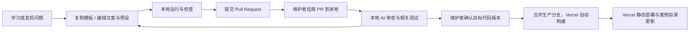

# 案例协议与社区贡献设计

状态：协议首期实现 v0.1.0，日期 2026-10-11。已实现仓库内核心类型、数值参数与快照校验、清单生成和三个案例；独立 SDK/CLI、脚手架和完整社区机制仍待实施。实际入口见 [本地开发](DEVELOPMENT.md)。

## 1. 一份贡献是什么

一个案例应回答一个清晰问题，例如“为什么改变振幅会影响大角度单摆的周期”。贡献者可以从纠正文案、增加一个参数预设、提出一道题开始，再进阶到新实验和底层算法。

贡献难度分三层：

| 路径 | 需要提交 | 适合谁 |
|---|---|---|
| 讲解/翻译/预设 | Markdown、JSON、引用 | 学习者、教师 |
| 新案例 | manifest、模型、视图、讲解和测试 | 会基本 TS/React 的贡献者 |
| SDK/求解器 | 算法、接口、兼容性与数值验证 | 熟悉计算与图形的开发者 |

后续可以提供 Issue 表单收集非程序员的案例草稿；网页创作器放到案例协议稳定之后。社区讨论可以使用 GitHub Discussions 的问答和展示区，当前尚未启用这些仓库功能。[GitHub Discussions](https://docs.github.com/en/discussions)

## 2. 案例包目录

以下路径相对于仓库的 frontend/；案例源码与构建依赖位于前端工作区。

```text
examples/physics/pendulum/
  manifest.json               # 可静态读取的元数据
  parameters.schema.json      # 参数 JSON Schema
  snapshot.schema.json        # 内部状态恢复格式
  model.ts                    # 不依赖 UI 的科学计算
  view.tsx                    # 使用 SDK 呈现
  lesson.zh-CN.md             # 原理与探究引导
  lesson.en.md                # 可选翻译
  presets.json                # 有限组可校验的参数
  questions.json              # 可选自测题
  model.test.ts               # 数值/边界测试
  preview.svg                 # 自有或获许可的封面
  assets/                     # 模型/纹理等
  ATTRIBUTION.md              # 素材作者、来源、许可证
```

元数据使用 JSON 而不是任意可执行 TS，目录构建器无需执行案例代码就能获取标题和标签。注册表由扫描与校验生成，不要求每位作者修改中心路由文件。

## 3. Manifest 示例

```json
{
  "schemaVersion": "1",
  "id": "physics.pendulum",
  "slug": "pendulum",
  "version": "0.1.0",
  "sdkRange": "^0.1.0",
  "title": { "zh-CN": "单摆：长度如何影响周期" },
  "summary": { "zh-CN": "调节摆长并计时，比较测量值与模型预测。" },
  "subjects": ["physics"],
  "levels": ["high-school"],
  "tags": ["oscillation", "period"],
  "learningObjectives": ["解释周期与摆长的关系", "识别小角度近似的适用范围"],
  "prerequisites": ["速度", "加速度", "三角函数"],
  "estimatedMinutes": 10,
  "layout": "lesson",
  "theme": "paper",
  "renderer": "svg",
  "entry": "view.tsx",
  "parameterSchema": "parameters.schema.json",
  "snapshotSchema": "snapshot.schema.json",
  "locales": ["zh-CN"],
  "lessons": { "zh-CN": "lesson.zh-CN.md" },
  "preview": "preview.svg",
  "authors": [{ "name": "示例作者" }],
  "licenses": { "code": "MIT", "content": "CC-BY-SA-4.0" },
  "capabilities": { "network": false, "audio": false },
  "modelAssumptions": ["理想细线", "质点摆球", "无空气阻力"],
  "references": [],
  "status": "draft"
}
```

这只是字段示意，示例作者不是实际贡献者。发布检查要求补齐有效引用、素材来源、可运行文件和审阅记录；`draft` 且引用为空的示例不应直接进入正式目录。

代码与教学内容的许可证是拟议默认，需要在首个公开发布前把实际 LICENSE 文件、范围与素材例外落实。当前案例使用 LicenseRef-All-Rights-Reserved 标记许可证尚未授予，ATTRIBUTION.md 记录实际来源，没有擅自采用 MIT/CC 或改动仓库许可。拟议默认是 MIT 用于代码、CC BY-SA 4.0 用于讲解和原创图示；第三方素材保留各自条件。[MIT 正文](https://opensource.org/license/mit)、[CC BY-SA 4.0](https://creativecommons.org/licenses/by-sa/4.0/)

三个版本字段的职责不同：schemaVersion 控制元数据格式，version 控制案例内容，sdkRange 控制运行时兼容性。更新模型应更新案例 version。当前清单记录覆盖 manifest、schema、模型、视图、测试、讲解、预设、题目、封面、来源声明的 contentHash；JS 使用 Vite 内容哈希文件名。路由只承载当前版本，快照严格拒绝其他版本；尚无 id + version 路由或旧发行归档，不承诺旧链接固定行为。

## 4. 参数、状态与教学联动

参数必须有类型、默认值、范围、步长、单位和标签。SI 单位作为模型内部标准，角度在 UI 显示为度时显式转换为弧度；参数改变、计算和显示不能各自保留不同的隐式单位。

示意参数表：

| key | 默认值 | 范围 | 模型单位 | 教学作用 |
|---|---:|---|---|---|
| length | 1 | 0.2–3 | m | 比较周期 |
| gravity | 9.81 | 1–20 | m/s² | 比较不同重力条件 |
| angle | 0.174533 | -1.396263–1.396263 | rad | 对比小角度与大角度 |

分享与恢复的数据外层至少包含：

```text
labId, labVersion, sdkVersion, snapshotSchemaVersion,
params, seed, simulationTime, internalState, camera, activeChapter
```

构建时预设、外部文件导入和 URL 参数执行同一套校验。非法数值、NaN、过大的数组、未知字段和不支持的版本不能直接进入计算模型。大快照通过 JSON 文件导出分享，短参数可用 URL fragment；URL 不放个人信息，不建立服务端快照存储。

模型、视图、讲解之间通过稳定的参数名和章节 id 联动。案例作者不能依赖网站私有 DOM id，也不能随意修改网站全局样式。SDK 应提供“突出某个对象”“切换预设”“推进教学步骤”等最小接口，复杂故事仍可在案例内编排。

## 5. 一份合格讲解

推荐顺序：提出问题 → 让学习者预测 → 操作变量 → 描述观察 → 解释机制 → 小测与反例 → 延伸实验。

每个案例至少交代学习目标、先修知识、操作方法、数学/科学依据、近似条件、一个值得思考的问题，以及作者和来源。允许简洁，不能只剩一张漂亮动画。

例如单摆先让学习者预测摆长变成四倍会发生什么，再计时比较，最后呈现公式和近似条件。答案不能用动画的表现替代推导，也不能把小角度公式应用到所有振幅而不说明。

自测题用于学习反馈，首期答案可随静态包发布，不用于正式考试评分。将来若做受控考试，需独立设计题目保密、评分和隐私机制。

## 6. 从学习到 PR

当前可用命令：

```sh
cd frontend
pnpm install --frozen-lockfile
pnpm dev
pnpm check:lab
pnpm typecheck
pnpm build
pnpm test:e2e
```

新案例目前复制现有目录并编辑元数据、模型、视图和讲解；没有 create:lab 或 --lab 参数。pnpm check:lab 校验全部清单并运行全部模型与状态测试。清单支持 lesson 布局、中文、有限数值参数；参数的 step/unit/title 属于项目 JSON Schema 注解，step 是 UI 步长而非 multipleOf 约束（避免弧度预设和浮点除法被错误拒绝）。协议稳定后再增加脚手架和独立 CLI。案例作者只启动前端即可预览，不要求 API 密钥、云账户或数据库。



PR 模板要求说明：学习目标、交互方式、模型假设、预期结果、截图、测试、引用、许可证、是否修改公共 SDK。纯文字纠错走轻量流程；算法修改需数值证据、AI 对假设与引用的审查，涉及无法确认的学科结论时交给具备相关知识的人核实。

案例 PR 本身就是前端源码的变更，合并即完成纳入。构建脚本扫描 manifest 并生成注册表，自动接入目录和懒加载入口，无需逐次手写后端路由。AI 若修正代码，修正后重新检查，而不是复制到另一个隐藏的内容源。

## 7. AI 审查契约

AI 审查在维护者本地工具中完成，不配置 GitHub Actions。网站运行时不调用 AI，也不建设审查后端。读取代码 diff、相关上下文、讲解、引用、测试结果与截图，输出：

- 被审查的 commit SHA 和被测试的合并结果。
- 工程问题：文件/位置、严重性、可复现证据、建议修复。
- 教学问题：公式、适用条件、误差、单位、讲解歧义与引用。
- 结论：通过、需要修复、需要补充证据；注明实际检查范围。

相关本地测试与构建验证通过且 AI 无未解决阻断项后，由维护者确认合并或推送。AI 的结论不能替代已知解、边界与守恒量测试；超时或失败保持“未完成”。新增提交使旧审查失效，AI 生成的修复也需重新验证。

PR 内容是审查对象，不能改变维护者要求。AI 使用维护者本地已有工具和授权；不把模型密钥提交到仓库或提供给前端构建。未知 PR 先阅读脚本与依赖，再在不带生产凭据的隔离环境验证。最终由维护者控制生产分支更新，Vercel Git 集成据此自动构建发布。具体流程见 [总体架构](ARCHITECTURE.md)。

## 8. 本地验证清单

| 检查 | 内容 | 失败时 |
|---|---|---|
| 清单校验 | 唯一 id/slug、合法路径、必填字段、版本兼容、引用 | 指向具体字段 |
| 文件与资源 | 缺失文件、越界路径、单资源大小、来源说明 | 拒绝发布 |
| 类型与构建 | TypeScript、依赖、独立案例打包 | 提供构建诊断 |
| 科学模型 | 已知解、边界、误差、守恒量或单调关系 | 不以视觉替代数值验证 |
| 交互冒烟 | 加载、改参、暂停、重置、恢复 | 保留失败截图 |
| 视觉 | 指定视口、固定时间/种子/相机的基线 | 差分图供审阅 |
| 访问性 | 键盘、名称、焦点、替代文字与减少动效 | 缺陷需修复或说明 |
| 产物预算 | 首包、纹理尺寸、明显卡顿 | 超预算需理由和优化 |

不要为每个文案改动重复跑所有重型实验。根据依赖图检查受影响案例；SDK 或共享渲染器变更才扩大范围。共享 SDK 或渲染器发行前，在本地扩大兼容性验证范围。

## 9. 社区维护机制

后续根据实际贡献者与开放计划建立 CONTRIBUTING、CODE_OF_CONDUCT、GOVERNANCE、SECURITY、LICENSES、Issue/PR 模板；当前仅有本设计文档与本地验证指南。按学科和 SDK 设置 CODEOWNERS，但在实际维护者加入前不编造用户名。CODEOWNERS 可以定义路径负责人，并配合仓库规则要求其审阅。[GitHub CODEOWNERS](https://docs.github.com/en/repositories/managing-your-repositorys-settings-and-features/customizing-your-repository/about-code-owners)

维护者分工：核心维护者管理 SDK 与发行；学科维护者审查教学与模型；贡献者提交案例、纠错、翻译与预设。同一人可兼任，不为每份贡献强制组织复杂委员会。

当前三个案例均标为 experimental，展示作者、版本、依据与模型限制，没有伪造教学审阅者或日期。正式发布前应区分“已完成教学审阅”和“实验性案例”，增加实际审阅记录。源代码修正会形成新版本；旧版保留并显示勘误提示，严重错误可撤下公开入口但记录处理原因。

贡献者保留署名，衍生案例记录上游案例和版本。社区重点鼓励“我通过这个例子理解了什么”和可复现的探索记录，避免以案例数量奖励低质量复制。

开放 API、插件生态、独立内容仓库和网页内创作都是后续能力。最早验证的社区里程碑是：一个没有参与核心开发的人，能够依据文档独立完成首个被合并的学习案例。
