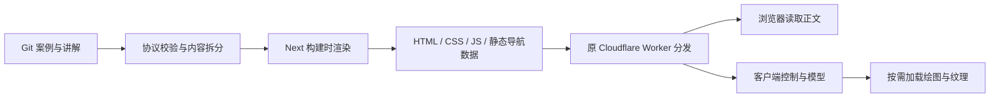

# Next.js 前端重构计划

更新：2026-10-13。状态：全量代码已迁移为 Next 静态导出；最终本地验收与性能结果见第 12 节。尚未提交、推送或发布。

初次规划的调研基线：`main`，HEAD `6d1ef4c4ca86fe3d3719955ff7b10c24bf632fb7`；初次调研开始时工作树干净。初次调研检查了页面、构建、案例加载、模拟运行时、三语言、SEO、部署配置和既有验证记录，并查阅官方文档，未重新构建、测量性能、检查生产平台或读取 Search Console。随后实施包的构建与测量另见第 11 节。

## 1. 目标与架构决定

采用 **Next.js App Router + 构建时静态生成 + 局部客户端交互**，由 Next.js 直接渲染首页、实验页面框架和讲解正文，替换现有 Vite 应用入口与自定义页面预渲染。通过 `output: 'export'` 交付静态文件，继续部署到现有 Cloudflare Workers Static Assets 的 `feynman` Worker。

目标是让搜索引擎直接读取完整、准确的内容，让读者尽早看到页面并操作实验，同时降低后续扩充案例的维护成本。Next.js 提供统一的路由、组件渲染和元信息机制；SEO 成效仍取决于内容、可抓取性、内链、性能和真实搜索反馈，不能以框架名称承诺排名或收录。[Google SEO 指南](https://developers.google.com/search/docs/fundamentals/seo-starter-guide)

| 决定 | 本轮方案 | 原因 |
| --- | --- | --- |
| 页面渲染 | App Router，内容组件在构建时渲染 | Git 内容随发布更新，当前没有按请求变化的页面内容 |
| 交付 | 静态导出，由原 Worker 分发 | 延续现有域名、CDN 和运维边界 |
| 实验 | 浏览器运行纯 TS 模型，SVG/Canvas/Three.js 按需绘图 | 参数操作不需要网络计算；保留已验证模型 |
| 内容 | 继续使用 manifest、Markdown、labels 和 schema | 案例贡献协议与 Git 内容源保持连续 |
| SEO | Next Metadata API 对接现有纯元信息规则 | 统一初始 HTML 与路由导航后的信息 |
| 视觉 | 先保持现有布局与视觉基线，改善加载与反馈 | 框架迁移和视觉重设计分别验收 |

初次规划只交付方案和文档。维护者随后授权按本计划开发，首个实施包完成 P0/P1，随后按维护者要求继续完整迁移。第 1–10 节保留初始规划依据，第 11 节为原型阶段历史，第 12 节记录最终实现。详见下方实施状态与 [本地复核](../tooling/ai-review/2026-10-13-next-p0-p1.md)。

### 渲染方式的取舍

| 方式 | 适配情况 | 决策 |
| --- | --- | --- |
| Next.js 静态生成/导出 | 三语言内容、目录、实验入口都能提前枚举 | 本轮采用 |
| 请求时 SSR | 当前没有用户专属或按请求变化的正文 | 不为本次迁移引入运行时服务器 |
| ISR | 内容规模与发布频率尚未证明需要增量更新 | 暂不采用；静态导出也不支持 ISR |
| 整页客户端渲染 | 不能实现减少内容 JS 和完整静态正文的目标 | 仅实验交互、搜索等需要浏览器状态的部分使用 |

静态导出中的 Server Components 在构建时执行，不要求线上 Node 服务。若未来确有运行时 SSR 需求，须另行设计 Cloudflare OpenNext 适配与运维，不能直接把服务端产物当静态文件上传。[Next 静态导出](https://nextjs.org/docs/app/guides/static-exports)、[Cloudflare Next.js 部署](https://developers.cloudflare.com/workers/framework-guides/web-apps/nextjs/)

## 2. 现状、证据与重构重点

| 当前实现 | 源码或记录（代码路径相对 frontend） | 迁移处理 |
| --- | --- | --- |
| 已有 24 个三语言 HTML 页面、21 个可收录 URL，包含正文、canonical、hreflang 和 JSON-LD | `packages/seo/pages.ts`、`scripts/prerender.ts`、[SEO](SEO.md) | 保持现有 SEO 能力，减少手工维护的渲染链路 |
| `App.tsx` 同时负责目录、实验回退、讲解、路径解析和导航；全页 hydrate | `apps/web/App.tsx`、`main.tsx`、`entry-server.tsx` | 拆为页面、静态内容组件和有限的交互组件 |
| 完整 catalog 含三个案例三语言 lessonHtml、章节和 schema，被浏览器入口引入 | `scripts/generate.ts`、`scripts/catalog.ts`、`App.tsx` | 拆分构建内容、轻量目录、当前语言搜索和实验配置 |
| 实验有 App → lazy LabPage → loaders[slug] → view 的加载链；view 同时导出 model/Readouts | `App.tsx`、`LabPage.tsx`、registry 生成逻辑 | 将模型/控制/读数与重型场景模块分离，减少串行等待 |
| Simulation 接收整个 Lab，章节操作还读取英文 content | `packages/runtime/simulation.ts` | 收窄运行时数据契约，解除对全文与翻译的依赖 |
| 语言切换用 History API，原 React 实验实例保留 | `packages/i18n/LanguageSwitcher.tsx`、`App.tsx` | 迁移到 Next 导航时明确处理组件卸载与状态恢复 |
| 贴图 import 在 Vite 中为 URL 字符串；浏览器类型来自 vite/client | `examples/geography/day-night/view.tsx`、`tsconfig.json` | 适配 Next 静态图片类型与 TypeScript 配置 |
| 发布目录 dist，哈希缓存匹配 /assets/*，Vite preview 驱动部分 E2E | `wrangler.jsonc`、`public/_headers`、`playwright.config.ts` | 切换输出目录、缓存路径及验证服务器 |

历史性能记录中，本地入口约 gzip 96 KB，地球绘图块约 gzip 240 KB、贴图约 272 KB；限速移动模拟下地球就绪中位数约 5.6 秒。这些是 2026-10-11 的旧版本实验室数据，只用于定位候选优化，不能作为当前 HEAD 或 Next 方案的实测结果。[性能基线](PERFORMANCE_BASELINE.md)

本轮优先解决内容数据进入首包、页面/模型/绘图加载耦合及渲染维护复杂度。Three.js 的下载、GPU 绘制和贴图解码仍需单独优化，不会随框架切换自动消失。

## 3. 目标代码结构与职责

继续以 `frontend/` 为唯一前端项目根目录，复用现有 packages/examples，不新建第二个长期应用。

```text
frontend/
  app/
    (en)/
      layout.tsx                 # 英文根布局，html lang=en
      page.tsx                   # /
      labs/[slug]/page.tsx       # /labs/:slug
      learn/[slug]/page.tsx      # /learn/:slug
    (localized)/[lang]/
      layout.tsx                 # zh、ja 根布局，映射为 zh-CN、ja
      page.tsx                   # /zh/、/ja/
      labs/[slug]/page.tsx
      learn/[slug]/page.tsx
  apps/web/
    components/                 # Header、Footer、卡片、静态问题区
    pages/                      # 三种页面共用实现；路由文件仅做适配
    client/                     # 搜索、语言选择、实验会话、场景宿主
    generated/                  # 构建专用内容和分拆后的可信加载映射
  packages/
    core/ runtime/ ui/ i18n/ seo/
  examples/                     # 既有三个案例和后续投稿
  scripts/                      # 内容校验、资源生成、导出检查
  tests/
  public/
  next.config.ts
  vitest.config.ts
  wrangler.jsonc
  out/                          # 拟定发布产物，不提交
```

上图是建议布局，P1 原型先验证完整 URL 与状态交接，再定稿。英文/本地化路由只传递 locale、slug，共用页面实现，不复制三份页面逻辑。根布局输出正确的 HTML 语言；不能先给所有静态页输出英文，再依赖客户端补改。[Next 根布局](https://nextjs.org/docs/app/api-reference/file-conventions/layout)

### Server / Client 边界

| 部分 | 渲染/运行位置 | 传输约束 |
| --- | --- | --- |
| 首页介绍、投稿区、页头页尾 | 构建时 Server Components | 客户端无需导入这些组件的实现 |
| 目录卡片与搜索 | 卡片初始 HTML 完整；交互区为小型 Client Component | 只传当前语言卡片数据和搜索字段，不带 lessonHtml |
| 完整讲解、核心答案、引用 | 构建时 Server Components | Markdown 解析、净化只在构建侧；正文可能进入当前页面的 RSC 数据，不能宣称零传输 |
| 实验标题、简介、问题与讲解链接 | 构建时输出，可作为 children 插入交互布局 | 实验脚本失败后仍有可读内容和可用链接 |
| 参数、播放、读数 | Client Components + 独立模型加载器 | 仅当前案例必要配置与当前语言文案 |
| 三维场景 | Client 场景宿主懒加载 | Three/R3F 和纹理只在需要该场景时下载 |

不要给整个路由或总入口加 `'use client'`。跨 Server/Client 边界只传可序列化数据或框架支持的渲染插槽，Simulation、模型函数和 GPU 资源由客户端创建。[Next 组件边界](https://nextjs.org/docs/app/getting-started/server-and-client-components)



## 4. 内容与案例加载重构

保留 scanCatalog 的 manifest/schema/三语言/七章/素材安全检查，将生成产物按使用方拆分：

| 产物 | 消费方 | 内容 |
| --- | --- | --- |
| 完整内容集合 | 构建侧页面与 SEO | 完整讲解、引用、元信息和协议校验结果 |
| CatalogCard[] | 当前语言首页 | id、slug、标题、摘要、标签、学科、封面、版本等必要字段 |
| `search-index.<locale>.json` | 当前语言搜索 | 保留现有标题/摘要/标签/学科搜索语义，不顺便增加全文搜索 |
| RuntimeLabConfig | 运行时 | id/version、参数 schema、快照 schema、必要章节数量等；不含三语言全文 |
| ExperimentCopy | 当前实验页面 | 当前语言简介、problem 内容、控件与读数文案 |
| 模型/读数/场景注册表 | 对应客户端模块 | 由校验通过的本地 manifest 生成显式 import，不拼接任意 URL |

首页可直接使用当前语言的轻量搜索字段，或按需读取索引，选择以实际传输量为依据，避免重复内联与请求同一数据。公共 catalog.json 和既有索引 URL 保持兼容；新增内部结构不泄漏作者数据，也不删除素材法定声明。

先复用 Markdown + 净化流程，不在迁移时将投稿内容改成可执行 MDX。保留七章稳定语义与顺序，若补章节锚点，仅由固定 chapter id 生成。构建内容模块禁止被 Client Component 间接 import，产物检查应捕获全文误入首页 JS 的回归。

LabModule 目前把 model、Readouts、默认 view 捆在一起。将加载契约拆开，地球案例先实现模型和读数独立导出；原始 view 可暂作兼容入口。Simulation 改为接收最小运行配置，继续保留模型行为、快照版本校验和数值测试。案例作者通常仍只新增目录，不手改中心路由。

## 5. URL、语言切换与实验状态

### 保留现有地址

| 页面 | 英文 | 中文 | 日文 |
| --- | --- | --- | --- |
| 首页 | `/` | `/zh/` | `/ja/` |
| 实验 | `/labs/:slug` | `/zh/labs/:slug` | `/ja/labs/:slug` |
| 讲解 | `/learn/:slug` | `/zh/learn/:slug` | `/ja/learn/:slug` |

路由动态参数全部由现有页面枚举与案例清单生成，严格限制 lang 为 zh/ja 和已发布 slug。使用 generateStaticParams，不开放请求时新增路径；英文不新增 `/en/`。未知语言、未知 slug、三语言 `/contribute` 仍返回真实 404。[Next 静态参数生成](https://nextjs.org/docs/app/api-reference/functions/generate-static-params)

Next 默认导出与当前混合尾斜线规则可能不同。建议保持页面无尾斜线，导出后只整理 `/zh`、`/ja` 首页 HTML 为对应 index.html；配合 Workers auto-trailing-slash 保持现有规范地址。相关 RSC 文件必须保持 Next 导航可访问，不盲目移动或重命名；P1 验证后定稿，不能用全站 SPA 回退解决。[Workers HTML 路由规则](https://developers.cloudflare.com/workers/static-assets/routing/advanced/html-handling/)

### 语言切换是单独的验收难点

以上多根布局之间的 Next 导航会完整加载页面，不能假设原 Session 自然保留。计划采用**内部的一次性实验会话交接**，同时在原型中测量跨语言切换开销；若出现不可接受的白屏或状态丢失，再调整路由布局。多根布局的完整加载行为见 [Next 布局说明](https://nextjs.org/docs/app/api-reference/file-conventions/layout)。

1. 切换前记录完整 simulation.snapshot()，额外记录 playing；现有 Snapshot 不含播放状态，restore() 会暂停，不能直接恢复后就认定完成。
2. 用当前标签页的 sessionStorage 短期交接记录连接语言导航，匹配 lab id、版本、目标路由和一次性导航标识；限制大小、有效期，消费后清理。直接打开、普通刷新或进入不同案例均不套用旧记录。
3. 目标页先校验并恢复参数、时间、seed、内部状态与相机，再按原 playing 恢复播放；导航等待不补算模拟时间。语言不写入科学快照。
4. 同一语言内优先 Next 客户端导航。浏览器前进/后退、跨根布局、BFCache 命中/未命中、快速连续切换和切换失败分别验证，确保不会取到过期交接数据。
5. 交接存储不可用或写入失败时，保持当前实验并给出可理解的失败反馈，不静默丢失状态。无 JavaScript 的语言链接照常打开对应静态页面。

这只是内部导航实现，不增加用户状态导入导出、长期学习记录或跨设备同步。生产上线门槛是全部已有状态保持测试及新增导航场景通过；若原型无法满足，先修正设计，不能删掉原有要求。

## 6. SEO 实施清单

保留现有 pageMetadata 和页面枚举的纯规则，移除对客户端 I18n 模块的依赖：翻译纯函数与 React Context 分离。Next 路由通过 generateMetadata 输出 title、description、canonical、语言替代链接、Open Graph 与 Twitter 信息；JSON-LD 由页面输出并继续安全转义。完成后删除旧 renderHead/applyMetadata，避免两套 head 同时生效。[Next Metadata API](https://nextjs.org/docs/app/api-reference/functions/generate-metadata)

| 检查项 | 完成标准 |
| --- | --- |
| 初始正文 | 21 个内容 URL 禁用 JS 均有当前语言正文；讲解保留完整七章、H1 后核心答案；实验保留简介、问题、封面和讲解链接 |
| 元信息 | 每页面唯一 title/description；实验/讲解各自 canonical；三语言自指与双向 hreflang、英语 x-default 正确 |
| 域名 | 仍取 site.config.ts 和经过校验的公开构建配置；不从请求或预览域名推断 |
| 导航 | 首次访问、软导航、语言切换及历史返回后的元信息、html lang 和可见正文一致 |
| 结构化数据 | 延续真实 WebSite、CollectionPage/ItemList、WebPage、LearningResource；不补虚构作者、日期、评分或 FAQ |
| sitemap / robots | 共用页面枚举；当前仍为 21 条。SITE_INDEXABLE=false 或非生产分支时所有页面 noindex 且无 sitemap 文件 |
| 404 | 正确语言的 404 正文与 noindex；无 canonical/hreflang/JSON-LD；未知 URL HTTP 状态为 404 |
| 资源与验证文件 | Google 验证文件、分享图、favicon、LICENSE 与第三方许可保留，正文与文件 URL 可访问 |
| 搜索与参数 | 不把站内搜索词、实验参数或导航状态生成独立索引 URL；canonical 去查询和锚点 |

首轮沿用 scripts/seo-files.ts 生成 robots/sitemap，在 Next 导出后写入 out；不再同时新增 app/sitemap.ts 或第二份 robots 生成逻辑。清理旧 sitemap，避免先允许索引再构建预览时遗留文件。

## 7. 用户体验与性能方案

### 尽早可读、尽早可操作

实验首屏直接输出最终布局框架，固定主图占位尺寸，保留问题和笔记链接，避免“文章封面 → 简单加载页 → 完整实验”的多次替换。客户端优先加载参数控制、模型与读数；场景准备期间保留静态示意，绘图完成后替换同一图框。模型未就绪前控件明确禁用，就绪后参数修改即生效，随后加载的场景读取最新模型状态。

对地球场景在 Client 宿主中使用动态导入；需要关闭预渲染的 Canvas 子树才使用 ssr: false。不能对整个实验页面关闭预渲染，也不能在 Server Component 中直接声明该选项。[Next 懒加载](https://nextjs.org/docs/app/guides/lazy-loading)

首页及讲解不得因链接预取拉取地球场景或贴图。对重型案例链接显式控制 prefetch，优先预取轻量路由内容，用生产网络记录验证实际行为。场景拆分后减少一层等待，是否进一步提前请求贴图由测量决定。

### 字体、图片、公式和失败回退

- 复用现有自托管字体及字重，控制 preload；先保证字体度量、换行和 CSS Modules 一致，不叠加在线字体请求。
- 封面/分享图保留尺寸与 alt；首屏关键图不延后加载，非首屏图片按需加载。静态导出没有默认运行时图片优化服务，可使用原生图片或 next/image 的静态兼容设置；生成响应式资源时单独测量收益。
- 地球 WebP import 在 Next 中可能为图片对象，TextureLoader 需使用正确的资源 URL（如 .src）并验证生产路径。纹理仍按案例加载，NASA 来源和授权保留。
- 讲解公式尽量构建时生成可读标记；实验动态公式仍由客户端更新。按页面引入 KaTeX CSS/字体，避免误把全部公式 JS 放入首页。
- 模块、纹理或 WebGL 失败时，保留说明、参数/读数及笔记链接，提供局部重试；路由级错误边界不能替代场景级回退。
- 保留键盘操作、可见焦点、语义标题、减少动效和手机布局；导航后焦点/滚动符合页面预期，语言切换不突然跳回实验初始状态。

### 明确待验证的预算

以下是重构目标，不是本次测试结果。P0 先复测当前 HEAD，再以同一 Chrome、硬件、视口、DPR、网络/CPU 限速、语言、默认状态及缓存条件比较。

| 指标 | 目标与判定方法 |
| --- | --- |
| 真实用户 CWV | 有足够样本时按移动/桌面分别观察 P75：LCP ≤2.5 s、INP ≤200 ms、CLS ≤0.1；数据不足标记未知 |
| 实验室内容加载 | 固定移动节流条件下，各代表页面 5 次冷启动中位数 LCP ≤2.5 s、CLS ≤0.1，保留异常样本 |
| 实验模型/控制就绪 | 上述条件下 5 次中位数 ≤2.0 s；用代码埋点记录真正可操作时刻，不再仅以元素出现判定 |
| 地球画面就绪 | 首帧且纹理就绪的中位数 ≤4.0 s；同时记录 Canvas 首帧与纹理完成，不能用 LCP 替代 |
| 参数响应 | 定义重复操作脚本，累计至少 100 次有效参数操作，输入到可见读数/绘图更新 P95 <100 ms；不称为 INP |
| 连续动画 | 代表性实体手机以 30fps、桌面以 60fps 为目标；持续 30 秒记录帧耗时分布、掉帧与设备条件 |
| 传输预算 | 首页/讲解不请求 Three/R3F/地球贴图；首页不含全部语言讲解；首屏实际总传输和 JS 分别与 P0 比较，新增框架成本需有可测量收益 |

CWV 阈值与百分位依据 [Web Vitals](https://web.dev/articles/vitals)。实验控制与场景阈值是项目拟定目标。原型如果超过旧版传输或延迟，先分析框架开销、RSC 载荷和模块拆分，不能以 Lighthouse 分数提升代替实际体验改善，也不为达标删除教学内容或扩大截图遮罩。

## 8. 构建、测试与部署迁移

### 工具链

以 Next.js 16 稳定线为候选，实施时查验受支持版本及安全修复，再固定精确补丁版本与 lockfile。不要直接使用 canary 或浮动 latest。现有 React/React DOM 19.3.0、R3F 9.8.1、TypeScript 5.9.3、Node 24.11.1、pnpm 12.10.1 都需要实际安装和构建兼容性验证，不能仅由版本范围推断通过。[Next 升级说明](https://nextjs.org/docs/app/guides/upgrading/version-16)

迁移 vite/client、JSX/Next 类型生成、图片声明、路径与构建环境读取；去掉 `__SITE_CONFIG__` 的 Vite define 注入。构建端读取并校验 SITE 配置，只向浏览器传公开字段，不整体暴露环境变量。Vitest 配置从 vite.config.ts 分离；Vitest 可能仍依赖 Vite，不以删除所有 Vite 依赖为迁移完成标准。

| 命令 | 迁移后拟定行为（尚不可按此当现状执行） |
| --- | --- |
| pnpm generate | 校验协议并生成分拆内容、映射与许可副本 |
| pnpm dev | 生成内容后启动 Next 开发服务；案例新增/讲解编辑有明确的再生成或监听路径 |
| pnpm typecheck | 内容生成、Next 路由类型生成、TypeScript 校验 |
| pnpm check:lab / pnpm test | 保留内容、模型和运行时单元验证 |
| pnpm build | 类型校验 → Next 静态导出 → URL/404/SEO 文件整理 → 产物一致性检查 |
| pnpm preview / pnpm preview:workers | Wrangler 本地静态服务，验证实际发布目录与路由规则 |
| pnpm test:e2e | Google Chrome 检查已构建产物；适配 Playwright 启动命令，移除 Vite 专用参数 |
| pnpm deploy:workers | 仍由 Wrangler 更新同一个 Worker；执行需有发布授权 |

Next 静态导出使用 next build，不引入已删除的 next export 命令；正式静态预览不用 next start。[静态导出说明](https://nextjs.org/docs/app/guides/static-exports)

### Cloudflare 适配

静态导出不执行 Next 的请求时重定向、响应头或 Proxy 逻辑。域名重定向继续交给既有 Zone Rule，静态路由和响应头由 Workers 配置承担，不把规则只写进 next.config 后就视为生效。

1. wrangler.jsonc 的 assets.directory 由 ./dist 改为 ./out；保留 Worker 名称、两个 Custom Domain、auto-trailing-slash 与 404-page。
2. _headers 为 /_next/static/* 的内容哈希文件设置长缓存；HTML、robots、sitemap 以及没有内容哈希的 RSC/路由载荷保持可更新，不把所有 /_next/* 或 .txt 一律设为 immutable。
3. 中文和日文的未知路径仍需各自最近目录的 404.html。由共用 404 组件在构建时生成三个语言的静态错误文件，最终返回码由 Workers 负责；验证 Next 内建错误产物不覆盖它们。后处理只处理发布文件，不重写正常页面正文。
4. Next 客户端导航可能请求额外静态 RSC 文件，必须整体发布并检查状态码、MIME 与缓存；不存在的 JS/JSON/纹理/RSC 文件仍返回 404。
5. .next/、out/、框架生成类型和新增测试产物加入适当忽略规则，不提交依赖或编译结果。保留 Google 验证文件、品牌图和许可文件。
6. Workers Builds 接入仍是独立待办；若迁移前接入，更新其构建配置；若尚未接入，继续本机构建后上传。两者都交付同一 Worker，不新增 GitHub Actions 或第二套生产通道。

### 新旧发布切换与回退

发布前记录目标 commit、构建配置、产物校验与上一已验证部署版本。迁移可在本地分阶段对照，最终仅发布一个完整 Next 产物集。检查旧浏览器标签页在部署后请求旧 chunk 的情况，提供明确的刷新恢复路径；不能假定平台永远保留所有旧哈希文件。

经授权发布后验证 www 深链接、裸域 301 保留路径/查询、三语言 HTML、元信息、robots/sitemap、验证文件、真实 404 和实验交互。出现正文缺失、索引策略错误、核心实验失效或大面积资源 404 时，按平台机制恢复上一完整已验证版本，再调查问题。发布验收记录与本地测试分开填写。

## 9. 实施阶段与交付门槛

按可审查的小改动推进；下表表示依赖顺序，不是自动创建 PR 或发布的授权。

| 阶段 | 工作与交付 | 进入下一阶段的条件 |
| --- | --- | --- |
| P0：建立对照 | 当前 HEAD 完整构建；导出 21 个规范 URL、3 个 404、SEO 字段；重新测量代表页；固定桌面/手机三语言截图 | 基线绑定 commit 和环境，性能与部署未知项明确 |
| P1：Next 最小原型 | 英/中/日首页和单摆入口；真实静态导出；验证根布局、状态交接、混合尾斜线、RSC 请求及多语言 404 | 单摆播放中切换语言及前进后退均保持状态；Wrangler 路由正确；确认精确依赖版本 |
| P2：内容与 SEO | 分拆内容集合；迁移目录和全部讲解；Metadata/JSON-LD、robots/sitemap、验证文件 | 全部内容无 JS 可读；首页不携带全文；所有元信息与旧规则一致 |
| P3：三个实验 | 收窄运行时契约；模型/读数/场景分离；二次函数无时钟、单摆比例、地球/失败回退验证 | 原有数值/状态检查通过；三语言桌面手机交互和资源清理通过 |
| P4：体验与收敛 | 加载骨架、按需请求、字体图片、无障碍、性能调优；删除旧入口和预渲染器 | 达到拟定预算或明确列出未达项及处理决定；无未解决的状态/SEO/路由阻塞 |
| P5：发布准备与验收 | 最终版本审查、更新操作文档、记录回退版本；获得发布授权后上线 | 源码与部署对应、正式 URL 验收；真实用户搜索效果继续观察 |

首个实施包建议只做 P0/P1。它能最早证明 Next、当前静态托管和多语言实验状态可以共同成立，避免迁完全部页面后才发现路由设计不适用。

### 最终验证矩阵

- 工程：清单、类型、模型、运行时测试与 Next 正式构建；检查开发 Strict Mode 下重复挂载不会产生双时钟或资源泄漏。
- 页面：3 个首页、9 个实验、9 个讲解及 3 个语言 404；直接访问、刷新、软导航、历史返回和禁用 JavaScript。
- 实验：参数边界、两种重置语义、播放/暂停/单步、隐藏页面、语言切换；保留现有几何、贴图和手机完整箭头要求。
- 故障：模型/场景块加载失败、纹理失败、WebGL 不可用、导航失败和状态交接失败；确认仍可读、可返回或重试。
- SEO/平台：全部 URL 的 HTTP 状态与 head；预览 noindex 且无 sitemap；未知语言/slug/贡献页/缺失资源真实 404；RSC 资源与缓存正确。
- 视觉/体验：Google Chrome 固定环境，桌面与手机、三语言、字体完成、默认实验状态；另做实体手机操作和持续动画测试。

讲解/模型继续保持 experimental，框架迁移不等于完成独立教学审阅。工程测试、实验室性能、真实设备检查、生产验收和搜索观测分别报告。

## 10. 文档同步与完成定义

本次在 AGENTS、ARCHITECTURE、SEO、ROADMAP 中加入计划入口，并明确“当前 Vite 实现 / 目标 Next 架构”。当前开发命令和部署历史保持真实，不提前改成已经迁移。

实施完成时再更新 DEVELOPMENT、DEPLOYMENT、三语言 README、CONTRIBUTING/案例协议、性能基线和视觉验收记录；记录删除的旧入口、调整的案例契约、实际精确版本和命令。SEO_GEO_PLAN 的历史成果保留，新增迁移后的观测记录，不覆盖旧数据。

只有 Next 已承担全部正常页面渲染、旧 Vite 应用入口与自定义正常页面预渲染退出、三语言与实验行为通过验证、构建可复现时，才标记“重构已实现”。正式生产验收完成后另标记“已部署”；索引、流量和学习体验提升需后续数据证明。

## 11. P0/P1 实施状态（阶段历史）（2026-10-13）

- P0：原 HEAD 的 Vite 24 页构建、44 项单元测试和 52 项 Workers 浏览器检查通过。保存 21 个规范 URL、3 个 404 的 head/HTML 摘要、三语言桌面/手机默认状态的 24 张截图，代表页各测 5 次。原始材料在忽略的 test-results-next-baseline；采集时工作树已含本轮文件，dist 来自实施前构建，记录区分构建来源和采集状态。
- P1：固定 Next 16.4.0，多根 App Router 布局，21 个静态内容 URL 和三语言 404 已经本地 Workers 验证。讲解提前渲染，首页只传当前语言卡片，单摆完整可交互；二次函数与地球在原型内仅有静态说明，完整交互继续由正式 Vite 入口提供。
- 语言交接用标签页 sessionStorage、随机导航标识和 history.state，不改变可见 URL。完整科学快照与 playing 分别恢复，支持普通历史加载与真实 BFCache；首次导航记录消费后清理。上限 16 KiB，会话有效期 5 分钟、首次交接有效期 30 秒；刷新/直接访问不应用旧状态。Chrome 的 BFCache Storage 视图在 pageshow 后更新，恢复在下一任务执行，并在完成前禁用控件。
- 原型统一 noindex、无 sitemap。build:next/preview:next/test:next 是临时本地迁移命令；wrangler.jsonc 正式目录仍为 dist，Worker、域名与 deploy:workers 未变。后处理仅整理 zh/ja 首页 HTML、共用错误内容、SEO 文件和缓存规则，不移动 RSC 载荷。
- 对照发现框架成本：首页 JS 传输高于旧版，单摆控件就绪约 2.4 秒，尚未达到 2 秒目标。状态与路由门槛满足，可继续 P2/P3；P4 必须处理预算差距，原型目前不满足生产切换条件。
- 没有生产验收、真实手机操作、独立教学审阅或搜索效果观测。官方已预告 10 月 14 日安全更新，发布前需复查补丁与适用范围。

环境、最终测试范围和测量限制见 [本轮记录](../tooling/ai-review/2026-10-13-next-p0-p1.md)。后续仍按 P2–P5 门槛推进，不把原型标记为全量重构完成。

## 12. 全量迁移完成与本地验收（2026-10-13）

维护者要求继续完成整个迁移后，P2–P4 已实现；当前默认前端统一为 Next.js 静态导出，旧 Vite 应用入口及正常页面预渲染器已退出。P5 的本地发布准备完成，正式上传/生产验收尚未执行。

- 内容与 SEO：21 个三语言内容 URL、3 个语言 404；完整讲解构建渲染，首页仅当前语言卡片。Next Metadata 适配纯规则，JSON-LD 安全转义，预览和非 main 强制 noindex/无 sitemap。
- 三个实验：完整交互保留；运行时收窄，控制器/读数与场景分离，公式及状态校验预编译，地球纹理按案例预加载且只请求一次。科学模型未改。
- 语言状态：完整快照及播放状态跨语言交接；历史、BFCache、普通笔记往返、过期/错误 token、存储失败、预检及最终文档失败恢复已验证；刷新重新初始化。
- 工具链：固定 Next 16.4.0、React 19.3.0、Node 24.11.1、pnpm 12.10.1。默认构建 out，完整 RSC/segment 静态文件一并交付，同一 Worker/域名/真实 404/无 SPA 规则保留。
- 验证：冻结安装、类型、51 项单元、24 页构建审计、正式及两种 noindex 构建通过；90 项浏览器检查通过、4 项按设计跳过；开发 Strict Mode 6 项通过；Wrangler dry-run 通过。

性能的最终样本、与 P0 的可比限制及处理决定见 [性能基线](PERFORMANCE_BASELINE.md#2026-10-13-next-全量迁移)。保留未达预算，不宣称全面性能达标。完整实现范围、截图环境与发布待办见 [全量复核](../tooling/ai-review/2026-10-13-next-migration.md)。三语言 README、工作约定、架构/开发/部署、案例协议、路线图、SEO 与视觉记录均已同步。本地实现完成不等于已经部署，实体手机、真实 CWV、独立教学审阅和搜索效果仍待单独验证。
